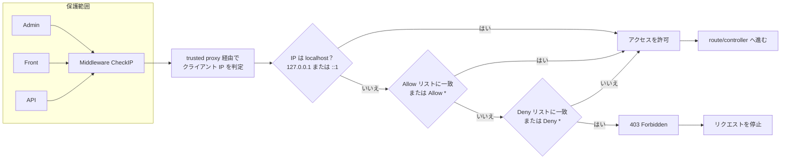

# CheckIP Plugin（日本語）

> 🌐 **言語:** [🇻🇳 Tiếng Việt](./readme_vi.md) · [🇬🇧 English](./readme.md) · 🇯🇵 日本語（現在）

CheckIP プラグインは、GP247 システムへのアクセス元 IP の管理とブロックを支援します。

> **GP247 Core 2.0 が必要です。** 管理画面は TailAdmin シェル（Livewire）上で動作します。

## 機能
- IP リストを **allow**（許可）と **deny**（拒否）の 2 種類で管理します。
- `*` 文字に対応：
  - allow の `*`：すべての IP を許可します。
  - deny の `*`：すべての IP をブロックします（すでに allow されている場合を除く）。
- 処理の優先順位：allow > deny。
- Livewire（TailAdmin）の管理画面で作成・編集・削除ができ、追加／編集フォームと allow/deny リストが横に並んで表示されます。
- 各レコードにステータス項目 `status`（ON/OFF）があり、設定項目をすばやく有効／無効にできます（新規作成時のデフォルトは ON）。

## Middleware
- クラス：`App\GP247\Plugins\CheckIP\Middleware\CheckIP`
- 処理の流れ（要約）：
  1. フレームワークからクライアント IP を取得します（`request()->ips()`）。trusted proxy の設定に従います（下記参照）。
  2. IP が allow リスト（または allow `*`）に一致する、または localhost（`127.0.0.1`、`::1`）の場合 => 許可します。
  3. そうでなく、IP が deny リスト（または deny `*`）に一致する場合 => 403 を返します。
  4. どれにも一致しない場合 => 許可します。

## クライアント IP と trusted proxy
クライアント IP は、Laravel が `request()->ips()` によって `config/trustedproxy.php`
（env の値 `TRUSTED_PROXIES`）に基づいて判定します。転送ヘッダー（`X-Forwarded-For`、`CF-Connecting-IP`）は、
明示的に宣言したプロキシから届いたものでない限り**信頼されません**。これにより、クライアントがヘッダーを偽装して
（例：`X-Forwarded-For: 127.0.0.1`）deny ルールをすり抜けることを防ぎます。

- **ベアホスト**（Nginx/Apache → PHP-FPM に直接）：`TRUSTED_PROXIES` は空のままにします。実際のクライアント IP は
  直接の接続元そのもので、信頼すべきプロキシはありません。
- **リバースプロキシ／Cloudflare の背後**：`.env` に `TRUSTED_PROXIES` を設定します（例：ローカルの
  `proxy_pass` なら `127.0.0.1`、または Cloudflare の IP 範囲）。これで実際の訪問者の IP を正しく取得できます。設定しないと、
  すべての訪問者がプロキシの IP として扱われ、allow/deny ルールが全員に一律に適用されてしまいます。
- **localhost**（`127.0.0.1`、`::1`）は常に許可されるため、ローカルからのアクセスがロックされることはありません。

> ⚠️ この Middleware は **Admin** 領域も保護します。信頼できる allow ルールでアクセスを確保していない限り、deny `*`（または
> ご自身の IP の deny）は設定しないでください。設定すると自分自身を締め出してしまい、復旧にはデータベースを直接
> 修正する必要があります。

## 動作フロー図

保護範囲：Admin、Front、API（いずれも Middleware `CheckIP` を経由します）。



## インストール
次のいずれかの方法でインストールできます（GP247 Store のプラグインドキュメントと同様）：

### 方法 1（手動）
1. ソースコードを `app/GP247/Plugins/CheckIP` フォルダーにコピーします。
2. Admin > Plugins で CheckIP プラグインを探し、インストールして有効化します。

### 方法 2（ZIP ファイルをインポート）
1. Admin > Plugins >「ファイルからインストール」タブを開きます。
2. プラグインの ZIP パッケージをアップロードし、インストールを確定します。

### 方法 3（ライブラリ）
1. Admin > Plugins >「プラグインライブラリ」タブを開きます。
2. 「CheckIP」を検索し、インストールをクリックします。

### 方法 4：コマンドラインでインストール（CLI、gp247 3.x）

gp247 3.x 以降では、管理画面を開かずに、**CheckIP** を GP247 ライブラリからダウンロードしてコマンドラインでそのままインストールできます。このプラグインはほかのパッケージを必要としません。サイトのルートフォルダーでターミナルを開き、次を実行します：

```bash
# 1) ウェブサイトごとに 1 回だけ：GP247 ライブラリに接続するための API License（無料）を登録
php artisan gp247:ext-register-license

# 2) ライブラリからプラグインをダウンロードしてインストール
php artisan gp247:ext-install --type=plugin --key=CheckIP
```

- ステップ 1 の前に、`.env` の `APP_URL` がサイトの**実際のドメイン**になっていること（`http://localhost` のままでないこと）を確認してください。ライセンスはこのドメインに紐付けられます。
- インストールが終わると、プラグインは**有効化済み**になり、キャッシュも自動で更新されるため、管理画面での追加操作は不要です。
- コマンドは `gp247.json` に宣言された条件（core のバージョン、composer パッケージ、依存プラグイン）を自動で確認します。不足があればコマンドは停止し、何が足りないかを明確に表示します。
- `app/GP247/Plugins/CheckIP` フォルダーがすでにサーバー上にある場合（手動でコピーした、またはインストーラーに同梱されていた場合）、コマンドは再ダウンロードせずに**その場でインストール**します。
- プラグインがすでにインストールされている場合、コマンドは実行を拒否します。新しいバージョンに上げるには `php artisan gp247:ext-update --type=plugin --key=CheckIP` を実行してください。
- コマンドの末尾に `--json` を付けると、機械で読み取れる形式で結果を受け取れます（スクリプト／CI 用）。
- 下記「有効化と使い方」の手順はそのまま必要です。
- 詳細：[プラグイン・テンプレートのインストールガイド](https://github.com/gp247net/gp247-docs/blob/main/extension/install-extension.md) · [コマンドリファレンス](https://github.com/gp247net/gp247-docs/blob/main/system/command-line-reference.md)。

## 有効化と使い方
- インストール後、Admin > セキュリティ > CheckIP（SECURITY グループ内のメニュー名）で管理します。
- レコードの作成：
  - `description`：短い説明。
  - `ip`：IP アドレス（例：`203.0.113.10`）または `*`。
  - `type`：`allow` または `deny` を選択。
  - `status`：ON で適用、OFF で一時的に無効化。
- 注意：`allow` は `deny` より優先されます。

## リンク
- 参考ページ（GP247 Store）：`https://gp247.net/en/product/plugin-checkip.html`
- GitHub（ソースコード）：`https://github.com/gp247net/CheckIP`

## ライセンス
このプラグインは GP247 が開発しています。

---
**最終更新:** 2026-10-22
